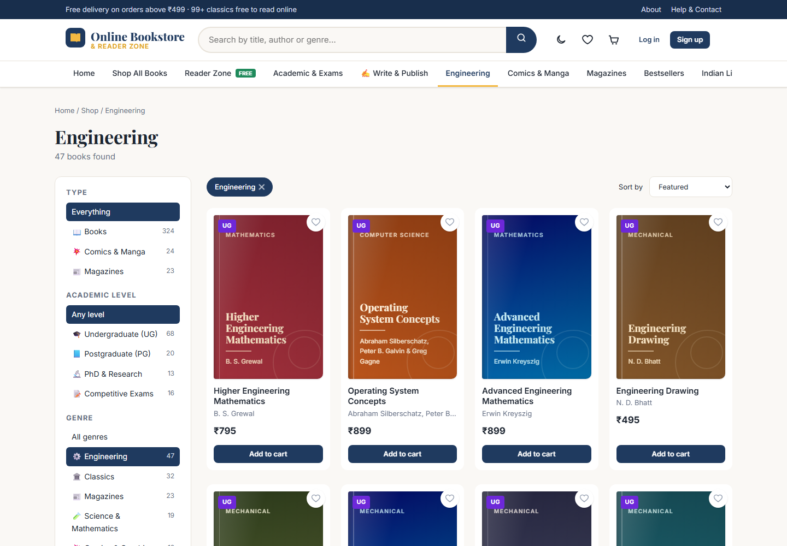
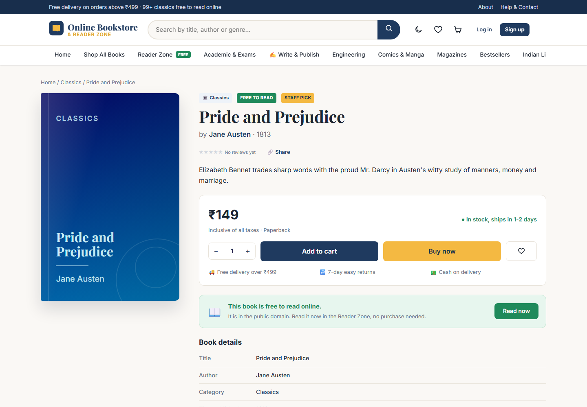
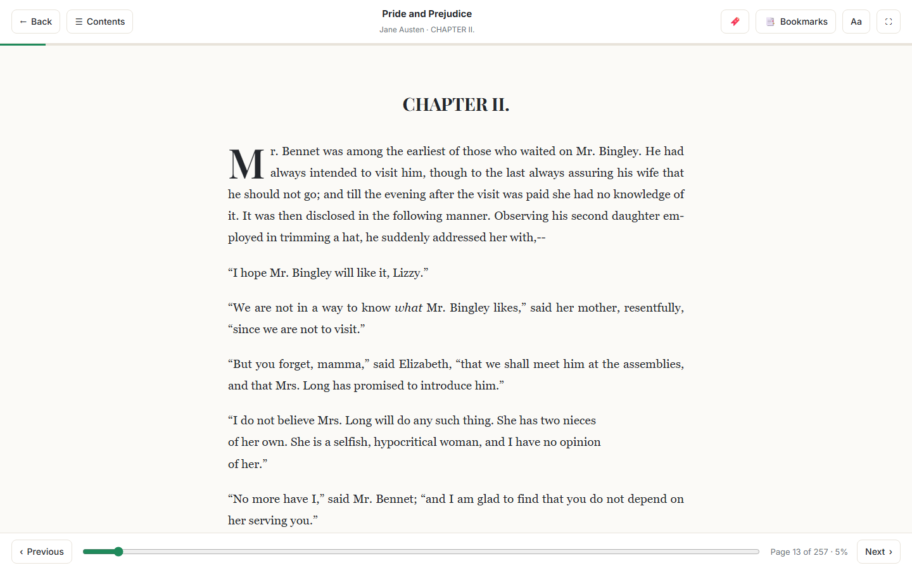
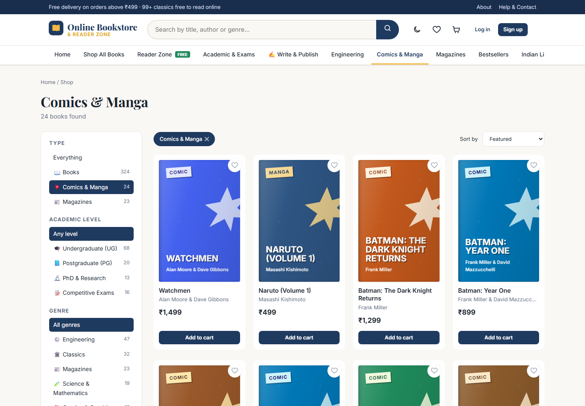
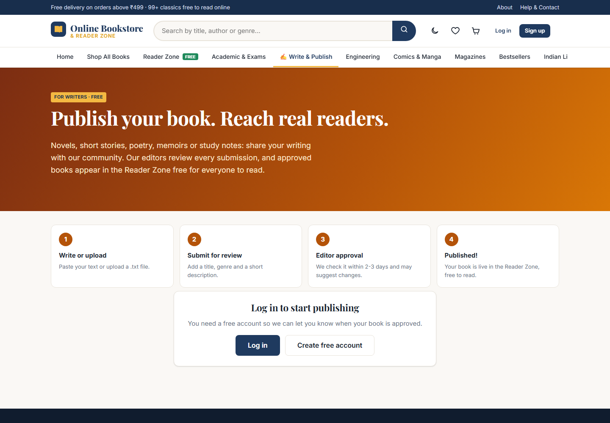
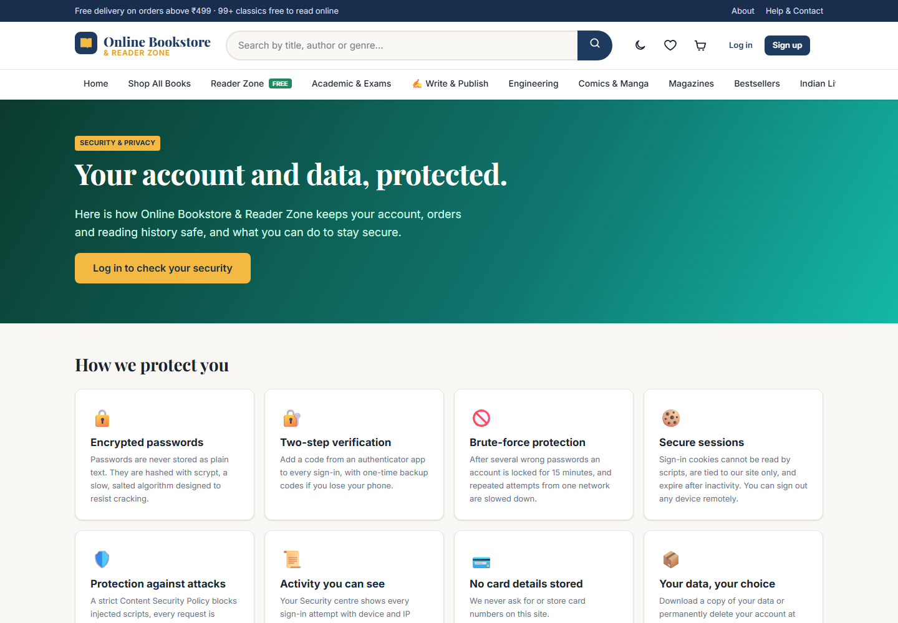
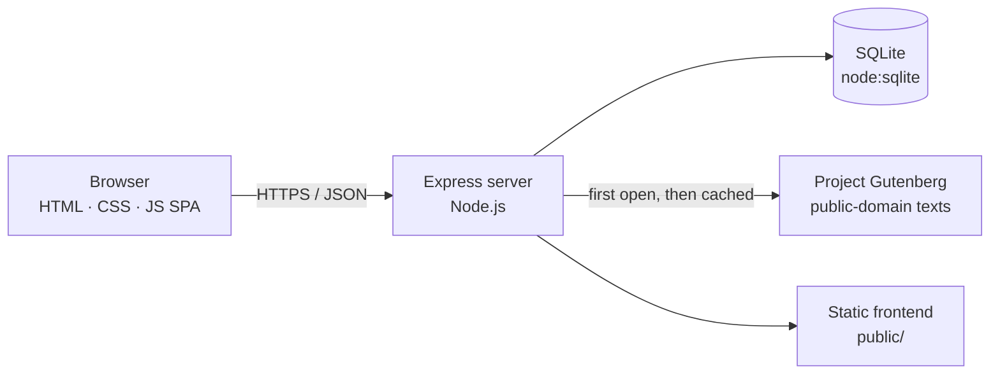

<div align="center">

# 📚 Online Bookstore & Reader Platform

**Buy books, read classics for free, and publish your own stories, all in one place.**

A full-stack web platform combining an online bookstore, a free in-browser e-reader,
community publishing with editorial review, and account security features such as two-step verification.

### [🌐 Live Demo: online-bookstore-and-reader-platform.onrender.com](https://online-bookstore-and-reader-platform.onrender.com)

[](https://online-bookstore-and-reader-platform.onrender.com)
[](https://nodejs.org)
[](https://expressjs.com)
[](https://nodejs.org/api/sqlite.html)
[](https://developer.mozilla.org/docs/Web/JavaScript)

[Screenshots](#-screenshots) · [Features](#-features) · [Tech Stack](#-tech-stack) · [Getting Started](#-getting-started) · [Deployment](#-deployment) · [Security](#-security) · [API](#-api-overview) · [Contact](#-contact)

<br>

<a href="https://online-bookstore-and-reader-platform.onrender.com"></a>

</div>

> [!NOTE]
> The live demo runs on Render's free plan. If it has been idle, the **first visit can take about a minute** to wake up.
> Demo data (accounts, orders, published books) is reset whenever the service restarts.

---

## 📖 About

**Online Bookstore & Reader Platform** brings together everything a reader needs:

- 🛒 **Shop** 541 titles across 30 categories, from bestselling fiction to engineering textbooks, comics, manga and magazines.
- 📖 **Read** 246 public-domain classics free in a comfortable, customisable online reader.
- ✍️ **Publish** your own writing. Editors review each submission before it goes live in the Reader Zone.
- 🎓 **Study** with textbooks organised by level (UG, PG, PhD) and exam (UPSC, JEE, NEET, CAT, SSC).

It is built without frontend frameworks or a database server: plain HTML, CSS and JavaScript on the client,
and Node.js with Express and Node's built-in SQLite on the server, so it is lightweight and easy to run anywhere.

---

## 📸 Screenshots

<table>
  <tr>
    <td width="50%"><p align="center"><b>Shop</b>: filters by type, level, genre and branch</p></td>
    <td width="50%"><p align="center"><b>Book page</b>: details, reviews and free reading</p></td>
  </tr>
  <tr>
    <td><p align="center"><b>Reader Zone</b>: chapters, themes and bookmarks</p></td>
    <td><p align="center"><b>Academic &amp; Exams</b>: UG, PG, PhD and competitive exams</p></td>
  </tr>
  <tr>
    <td><p align="center"><b>Comics &amp; Manga</b>: graphic novels and manga</p></td>
    <td><p align="center"><b>Write &amp; Publish</b>: community books with editor review</p></td>
  </tr>
  <tr>
    <td><p align="center"><b>Security &amp; Privacy</b>: how accounts are protected</p></td>
    <td><p align="center"><b>Dark mode</b>: follows your system theme</p></td>
  </tr>
</table>

<p align="center">
  <br>
  <b>Mobile</b>: responsive layout with a bottom tab bar
</p>

---

## ✨ Features

### 🛒 Bookstore
| | |
|---|---|
| **Large catalog** | 541 titles in 30 categories: classics, fiction, mystery, sci-fi, fantasy, Indian and Hindi literature, self-help, business, biography, and more |
| **Academic & exams hub** | Engineering (CS, Mechanical, Electrical, Electronics, Civil, Chemical), Medical, Science & Maths, Commerce & MBA, Humanities, PhD research methods, and competitive exam guides |
| **Comics, manga & magazines** | Graphic novels, Indian comics, popular manga volumes, and news, business, science and exam-prep magazines |
| **Smart browsing** | Live search suggestions, filters by type, academic level, genre, subject/branch, language, price and stock, plus sorting and pagination |
| **Cart & checkout** | Guest cart that merges on login, free delivery over ₹499, coupon codes, Cash on Delivery / UPI / Card (payments simulated) |
| **Orders** | Order history with a delivery tracker and self-service cancellation |
| **Reviews & wishlist** | Star ratings and written reviews, wishlist, recently viewed books, share buttons |

### 📖 Reader Zone
- 246 public-domain classics (Pride and Prejudice, Sherlock Holmes, Kim, Heidi, Frankenstein, Gitanjali, Shakespeare and more), streamed from Project Gutenberg and cached on the server
- Automatic chapter detection with a table of contents, page slider, keyboard navigation and swipe gestures on phones
- **Day, sepia, dark and night** themes with adjustable font, text size, line spacing and page width
- Bookmarks with notes, and reading progress synced to your account (or saved in the browser for guests)

### ✍️ Write & Publish
- Members write or paste their book, or upload a `.txt` file, with live word count, reading-time estimate, preview and an auto-saved draft
- Admins review submissions in a dedicated queue: read the manuscript, then **approve and publish** or **send it back** with feedback
- Published community books get their own page and a "From our community writers" shelf, free to read

### 🛠️ Admin Panel
- Dashboard with revenue, orders, customers, top sellers and low-stock alerts
- Manage books (add, edit, delete), orders (status updates), customers (roles, sign-out) and contact messages
- Book submission review queue and a **Security** tab with failed sign-ins, locked accounts and an audit log

### 🎨 User Experience
- Fully responsive layout with a bottom tab bar on phones
- Dark mode that follows your system setting, accessible markup and keyboard shortcuts (press <kbd>/</kbd> to search)
- Generated book covers with distinct styles for books, comics and magazines

---

## 🧰 Tech Stack

| Layer | Technology |
|---|---|
| **Frontend** | HTML5, CSS3 (custom properties, grid, container queries), vanilla JavaScript single-page app with hash routing |
| **Backend** | Node.js 22+, Express 4, REST API |
| **Database** | SQLite via Node's built-in `node:sqlite` module (no separate database server) |
| **Security** | scrypt password hashing, TOTP two-step verification (RFC 6238), QR codes with [`qrcode`](https://www.npmjs.com/package/qrcode) |
| **Content** | Public-domain texts from [Project Gutenberg](https://www.gutenberg.org) |
| **Hosting** | [Render](https://render.com) via an infrastructure-as-code blueprint (`render.yaml`) |

### Architecture



---

## 🚀 Getting Started

### Prerequisites
- [Node.js](https://nodejs.org) **22.13 or newer** (tested on Node 24)

### Installation

```bash
# 1. Clone the repository
git clone https://github.com/digvijay165/Online-bookstore-and-reader-platform.git
cd Online-bookstore-and-reader-platform

# 2. Install dependencies
npm install

# 3. Create your private settings file and set an admin email and password
cp .env.example .env

# 4. Start the server
npm start
```

Open **http://127.0.0.1:3000**. On Windows you can also double-click `start.bat`.

On first start the database is created automatically, the catalog is loaded, and the admin account is created
from your `.env` settings. Sign in and open **Admin Panel** from the menu.

### Configuration

All settings are environment variables (or lines in `.env`):

| Variable | Description | Default |
|---|---|---|
| `ADMIN_NAME` / `ADMIN_EMAIL` / `ADMIN_PASSWORD` | First admin account, created only if no admin exists | random password printed once if empty |
| `PORT` / `HOST` | Address the server listens on | `3000` / `127.0.0.1` |
| `HTTPS_ONLY` | `1` behind HTTPS: secure cookies and HSTS | off |
| `TRUST_PROXY` | `1` behind a hosting proxy (Render, Nginx) for correct visitor IPs | off |
| `DATA_DIR` | Folder for the database and cached texts (e.g. a persistent disk) | `./data` |

Store settings such as coupons, shipping and security limits live in [`src/config.js`](src/config.js).

### Coupon codes

| Code | Offer |
|---|---|
| `WELCOME10` | 10% off orders over ₹299 (up to ₹200) |
| `STUDENT15` | 15% off textbooks and exam books (up to ₹500) |
| `READ50` | ₹50 off orders over ₹499 |
| `FREESHIP` | Free delivery on any order |

---

## ☁️ Deployment

The project includes a [Render Blueprint](render.yaml) for one-click deployment.

[](https://render.com/deploy?repo=https://github.com/digvijay165/Online-bookstore-and-reader-platform)

1. Click **Deploy to Render** and sign in.
2. Enter a strong `ADMIN_PASSWORD` when asked. It is stored securely by Render, never in the repository.
3. Click **Deploy Blueprint**. The site is live in a few minutes, and every push to `main` redeploys it automatically.

> [!TIP]
> The free plan does not keep the SQLite database between restarts. For permanent data, switch to a paid instance,
> attach a disk (for example at `/var/data`) and set `DATA_DIR=/var/data`.

---

## 🔐 Security

Security was designed in from the start:

- **Passwords:** salted **scrypt** hashing; common, weak and email-based passwords are rejected
- **Two-step verification:** authenticator-app codes (TOTP) with QR setup, replay protection and 8 single-use backup codes
- **Brute-force protection:** accounts lock for 15 minutes after 5 wrong passwords, plus per-IP and site-wide rate limits
- **Sessions:** random 256-bit tokens in `HttpOnly`, `SameSite`, `Secure` cookies with idle timeout, a device list and remote sign-out
- **Web protections:** strict **Content Security Policy**, CSRF checks (custom header + Origin), clickjacking protection, `Permissions-Policy`, COOP/CORP, HSTS
- **Data safety:** parameterised SQL everywhere, output escaping, request size limits, `no-store` on API responses
- **Transparency:** users see their sign-in history; admins get an **audit log** of every admin action
- **Privacy:** users can download all their data or permanently delete their account

Found a vulnerability? Please email **digvijaysingh5360@gmail.com** rather than opening a public issue.

---

## 🔌 API Overview

All endpoints are under `/api` and exchange JSON. State-changing requests require the `X-Requested-With: fetch` header.

| Area | Endpoints |
|---|---|
| **Catalog** | `GET /books` (search, filters, sorting, pagination) · `GET /books/:id` · `GET /genres` · `GET /facets` · `GET /stats` |
| **Auth** | `POST /auth/register` · `POST /auth/login` · `POST /auth/login/2fa` · `POST /auth/logout` · `GET /auth/me` |
| **Security centre** | `GET /auth/security` · `DELETE /auth/sessions/:id` · `POST /auth/2fa/setup` · `POST /auth/2fa/enable` · `GET /auth/export` · `DELETE /auth/account` |
| **Shopping** | `GET/POST/PUT/DELETE /cart` · `/wishlist` · `POST /coupons/apply` · `POST /orders` · `GET /orders` |
| **Reader** | `GET /books/:id/text` · `GET/PUT /progress/:id` · `GET/POST/DELETE /bookmarks` |
| **Publishing** | `POST /submissions` · `GET /submissions/mine` · `PUT /submissions/:id` |
| **Admin** | `/admin/stats` · `/admin/books` · `/admin/orders` · `/admin/users` · `/admin/submissions` · `/admin/security` |

---

## 📁 Project Structure

```
Online-bookstore-and-reader-platform/
├── server.js              # Express app: security headers, sessions, routing, static files
├── render.yaml            # Render deployment blueprint
├── .env.example           # Template for private settings (copy to .env)
├── data/
│   └── books.json         # Catalog used to seed the database
├── src/
│   ├── config.js          # Ports, security limits, shipping and coupons
│   ├── db.js              # SQLite schema, migrations and seeding
│   ├── security.js        # Password hashing and policy, TOTP, auth middleware, validation
│   ├── audit.js           # Sign-in events and admin audit log
│   └── routes/            # auth · books · shop · reader · publish · admin
└── public/
    ├── index.html         # Single-page app shell
    ├── css/style.css      # Styles, dark mode and responsive layout
    └── js/                # app.js (frontend app) · theme.js
```

---

## 🗺️ Roadmap

- [ ] Real payment gateway integration (e.g. Razorpay)
- [ ] Email notifications for orders and publishing decisions
- [ ] Password reset by email
- [ ] Cover image uploads for community books
- [ ] PostgreSQL option for larger deployments

---

## 🙏 Acknowledgements

- Free classics courtesy of [Project Gutenberg](https://www.gutenberg.org), the oldest digital library of public-domain books
- Badges by [Shields.io](https://shields.io) · Fonts by [Google Fonts](https://fonts.google.com)

---

## 📬 Contact

**Digvijay Singh**

- GitHub: [@digvijay165](https://github.com/digvijay165)
- Email: [digvijaysingh5360@gmail.com](mailto:digvijaysingh5360@gmail.com)
- Live project: [online-bookstore-and-reader-platform.onrender.com](https://online-bookstore-and-reader-platform.onrender.com)

<div align="center">

⭐ **If you like this project, consider giving it a star!** ⭐

</div>
